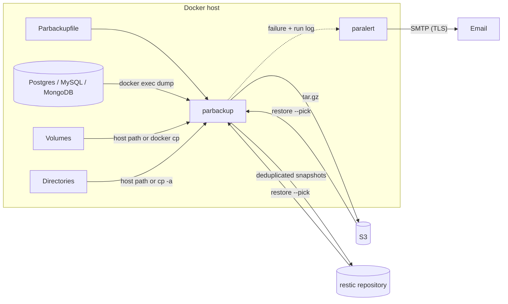

# par-server-tools

Back up and restore entire Docker Compose deployments with one config file and one command. Plain Bash on the host: no daemon, no extra container, no changes to your `docker-compose.yaml`.

## Tools

- [**parbackup**](./parbackup/): backup and restore of Docker deployments
  - Postgres, MySQL and MongoDB dumps, Docker volumes and host directories in one Parbackupfile
  - Retention, cron scheduling and failure alerts
  - Two backends: a self-contained `.tar.gz` per run on S3, or deduplicated and encrypted restic snapshots
- [**paralert**](./paralert/): email alerts over SMTP with mandatory TLS
  - parbackup reports failed backups through it
  - On its own it reports disk usage and failing commands or cron jobs
- [**par**](./par/): manages the installed tools
  - `par update` pulls the repository and links new tools
  - `par version` lists the version of every tool

## Motivation

- **One file per deployment:** a `Parbackupfile` lists databases, volumes and directories.
- **One-command restore:** `parbackup restore --pick` restores everything, databases included.
- **Matching dump versions:** dumps run inside the database container via `docker exec`.
- **Nothing in the background:** Only bash and cron, no daemon, no container.
- **Tested end to end:** real Postgres, MySQL, MongoDB, S3, restic and SMTP in the test suites.

## How it works



## Quick start

```bash
# Install (as root)
git clone https://github.com/parthec-de/par-server-tools.git /usr/local/share/par-server-tools
/usr/local/share/par-server-tools/install.sh

# Configure S3, the backend and, optionally, alert emails
parbackup config set
paralert config set

# Describe the deployment in a Parbackupfile (see the parbackup README), then:
parbackup create -f /opt/my-project/Parbackupfile
parbackup cron -f /opt/my-project/Parbackupfile --schedule "0 3 * * *"

# Restore later
parbackup restore --pick
```

## Limitations

- **Builtin backend:** no encryption and no deduplication, every run uploads a full archive, including the `Parbackupfile` with its database passwords. Keep the bucket private.
- **S3 only** as remote target, for both backends.
- **Email only** as alert channel.
- **Single host:** no central overview across servers.
- **Debian and Ubuntu** for auto-installing dependencies (`apt`).

## Alternatives

**parbackup**

- [offen/docker-volume-backup](https://github.com/offen/docker-volume-backup): runs as a container in the compose stack and backs up volumes. Database dumps via custom hooks, manual restore.
- [nfrastack/db-backup](https://github.com/nfrastack/db-backup): databases only, but nine engines, incremental backups and encryption.

restic is available as a backend of parbackup. Standalone, it writes encrypted, deduplicated snapshots to many storage types (local disk, SFTP, S3, B2, Azure, GCS), but leaves the database dumps and their restore to you.

**paralert**

- [Monit](https://mmonit.com/monit/): full monitoring daemon with its own config language. Checks processes, ports and certificates, restarts services, has a web UI. paralert only covers disk usage and failing commands, but needs no daemon and can be called from any script.

## Installation

Clone the repository into `/usr/local/share/par-server-tools` and run the installer, which symlinks each tool into `/usr/local/bin`. Run as root so it can write to `/usr/local`:

```bash
git clone https://github.com/parthec-de/par-server-tools.git /usr/local/share/par-server-tools
/usr/local/share/par-server-tools/install.sh
```

Override the install prefix with `PAR_PREFIX` (default `/usr/local`).

## Update

`par update` pulls the repository and links tools that appeared since the last run:

```bash
par update
```

`par version` shows what is installed:

```bash
par version
```

Re-running `install.sh` does the same as `par update`.

## License

[Apache License 2.0](./LICENSE), attribution in [NOTICE](./NOTICE).
